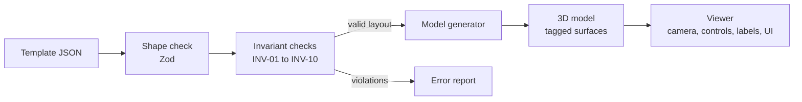

# Plan for feature 001: View a BTO template in 3D

**Status:** Draft, awaiting owner approval of dependencies (section 9)
**Spec:** [spec.md](spec.md) (approved 2026-10-28)
**Created:** 2026-10-28

The spec says what to build. This plan says how: the technology, the data format, how the pieces fit together, and how each requirement gets checked. Each choice includes a short "why" and the alternatives considered, so you can follow the reasoning.

## 1. Summary

A static website, written in TypeScript, that:

1. loads a template file (JSON) describing the flat,
2. checks it against the spec's invariants,
3. turns it into a 3D model with Three.js,
4. shows the model with dollhouse and plan views, room labels, and touch and mouse controls.

There is no server and no database. The website is a set of files that any static host can serve, starting with GitHub Pages.

## 2. Technical context

| Item | Choice |
|---|---|
| Language | TypeScript |
| Runtime for tools and tests | Node.js (v25.9.0 installed locally; CI uses Node 24 LTS) |
| Package manager | npm (comes with Node) |
| 3D library | Three.js |
| Build tool and dev server | Vite |
| Data checking | Zod (shape) plus our own invariant checks (rules) |
| Geometry operations | martinez-polygon-clipping |
| Tests | Vitest (unit), fast-check (property), Playwright (browser end-to-end) |
| Hosting | GitHub Pages (static files) |
| Target | Current Chrome, Safari, Edge and Firefox, desktop and mobile |
| Performance budget | Under 50,000 triangles. JavaScript under 300 KB compressed. Interactive within 5 s on a mid-range phone. |

## 3. Research findings

These answer the spec's open questions 3 to 5.

### 3.1 Standard HDB dimensions

| Item | Value used | Source |
|---|---|---|
| Floor-to-floor height | 2800 mm | HDB Precast Pictorial Guide 2014, clause 1.5 |
| Floor-to-ceiling height | 2600 mm | Typically 2575 to 2600 mm for BTO flats, per [Qanvast](https://qanvast.com/sg/articles/standard-hdb-ceiling-heights-what-you-cancannot-do-to-alter-them-3527), which cites HDB. Consistent with the 2800 mm floor-to-floor height minus the floor slab. Not yet confirmed on an HDB page. |
| Facade wall (living, bedrooms) | 150 mm | Precast Pictorial Guide, Fig 2A (K1F) |
| Facade wall (bathroom, service yard, corridor) | 100 mm | Precast Pictorial Guide, Fig 2A (K1HF, KP) |
| Wall between neighbouring flats | 100 mm (living/dining), 120 mm (kitchen) | Precast Pictorial Guide, Fig 2A (FW) |
| Gable-end wall | 175 mm minimum | Precast Pictorial Guide, Fig 2A (KGW) |
| Household shelter walls | 250 mm (buildings under 40 storeys), 300 mm (40 storeys or more) | Precast Pictorial Guide, Fig 2A (HW) |
| Household shelter interior | At least 2.8 m² and 1200 mm wide for a 4-room flat. Sizes in 50 mm steps. | [SCDF TRHS 2023, clause 2.2](https://www.scdf.gov.sg/home/civil-defence-shelter/acts-and-requirements/technical-requirements-for-household-shelters-2023/chapter-2-architectural-requirements/clause-2.2-size-of-hs) |
| Columns | At least 200 × 200 mm | Precast Pictorial Guide, Fig 2D |
| Internal partitions (bedroom walls) | 100 mm, **assumed** | No official figure found. To be checked against the plan image. |
| Bedroom door | 900 mm wide × 2100 mm high, **assumed** | Retail sources only (about 800 to 930 mm wide) |
| Main door | 900 mm wide × 2100 mm high, **assumed** | Retail sources only |

The precast guide is [published by BCA](https://bca.gov.sg/publications/BuildabilitySeries/others/HDB_Precast_pictorial_guide_BCA.PDF). It dates from 2014, so newer blocks may differ slightly.

**INV-01 wall thickness range:** 75 to 300 mm. This covers everything from thin partitions to the thickest shelter walls.

### 3.2 What "internal floor area" includes

An official HDB document lists a flat's internal floor area separately from a total that adds the air-con ledge ([HDB Annex A](https://www.hdb.gov.sg/cs/infoweb/-/media/doc/SCEG/10122020-Annexes/10122020-Annex-A.pdf)). Your plan says the same: 90 sqm total, 86 sqm internal plus the ledge. So the **ledge is excluded**.

I found no official statement on whether internal walls, columns and the shelter count. **Assumption A-1:** internal floor area is everything inside the inner face of the external walls, including internal partitions, columns and the household shelter, and excluding the air-con ledge. The validator reports both this figure and the sum of clear room areas, so the assumption can be revisited if a better source turns up.

**INV-06 tolerance:** 3%, to be confirmed against this template.

### 3.3 Calibrating the scale without circular reasoning

The plan image has no dimensions. A tempting shortcut is to pick the scale that makes the area come out at 86 sqm. That would make INV-06 pass automatically for this template, so the check would prove nothing.

So calibration uses **only independent references**:

- shelter wall thickness (250 mm),
- facade thickness (150 mm),
- shelter interior (at least 1200 mm wide and 2.8 m²),
- bedroom widths compared with the bay widths on a 4-room plan in the Precast Pictorial Guide (Fig 2B dimension strings of 2775 to 3325 mm).

The 86 sqm figure is then held back as the independent check: INV-06 must pass on its own.

This is the article's held-out-test idea: the evidence used to build something must not also be the evidence used to judge it.

A rough first reading of the image in chat gives about **10 mm per pixel**. On that scale, the bedrooms come out about 2.8 m wide and the shelter interior about 1.3 × 2.4 m, which agree with the references above. The real calibration happens on the saved file (task list, phase 3).

Coordinates are rounded to a 25 mm grid, since image pixels are noisier than real construction sizes.

## 4. Architecture



Each box is a separate module with one job, and data flows one way. This is called a **pipeline**. It matters for later features:

- **Feature 002 (themes)** only changes how tagged surfaces are coloured. Nothing upstream changes.
- **Feature 005 (plan upload)** produces a layout from a picture, then feeds it into the same shape and invariant checks (Constitution P3).
- **Feature 007 (export)** reads the same 3D model the viewer shows.

**Why two layers of checking.** The shape check answers "is this the right kind of data?", for example "does every wall have a thickness, and is it a number?". The invariant checks answer "does this data make sense as a flat?", for example "do rooms overlap?". Keeping them separate keeps each one simple. The invariant code can also assume the shape is already correct.

**Why the generator has no screen.** The model generator only builds geometry. It never draws to a screen, so it runs in tests on Node without a browser. That makes INV-10 (determinism) and SC-004 (1 mm accuracy) testable in milliseconds.

## 5. Data model

A template is one JSON file. All lengths are whole millimetres. Plan coordinates have x increasing to the right and y increasing down the page, matching the source image, so tracing is direct. The origin is the top-left corner of the flat's outline.

```json
{
  "schemaVersion": 1,
  "meta": {
    "id": "4room-a",
    "name": "4-Room (Type A)",
    "flatType": "4-room",
    "statedInternalAreaSqm": 86,
    "statedTotalAreaSqm": 90,
    "source": "HDB brochure image, owner-provided, 2026-10-28",
    "indicative": true
  },
  "ceilingHeightMm": 2600,
  "walls": [
    { "id": "w-facade-1", "start": [0, 0], "end": [4200, 0], "thicknessMm": 150, "structural": true }
  ],
  "columns": [
    { "id": "c-1", "outline": [[0, 0], [300, 0], [300, 300], [0, 300]] }
  ],
  "openings": [
    { "id": "d-main", "kind": "door", "wallId": "w-entrance", "offsetMm": 400, "widthMm": 900, "heightMm": 2100, "swing": "inward-left", "mainEntrance": true },
    { "id": "win-1", "kind": "window", "wallId": "w-facade-1", "offsetMm": 600, "widthMm": 1800, "heightMm": 1200, "sillMm": 900 }
  ],
  "rooms": [
    { "id": "r-living", "type": "living_dining", "name": "Living/Dining", "zone": "internal", "outline": [[150, 150], [3000, 150], [3000, 4500], [150, 4500]] }
  ],
  "openConnections": [
    { "rooms": ["r-living", "r-kitchen"] }
  ]
}
```

Design decisions:

- **Walls are centrelines plus thickness.** This matches how floor plans are drawn and how walls get moved later (feature 003).
- **Openings belong to a wall** and are placed by distance along it. Moving the wall moves its doors with it, and INV-02 is a simple range check.
- **Which rooms a door connects is calculated, not stored.** The generator looks at both sides of each door. Storing it as well would create two sources of truth that could disagree (Constitution P2).
- **Open connections are stored**, because no geometry marks them. They are checked to make sure the two rooms really do share an edge with no wall on it.
- **Room types are a fixed list:** `living_dining`, `bedroom`, `master_bedroom`, `bathroom`, `kitchen`, `service_yard`, `household_shelter`, `aircon_ledge`. Themes (feature 002) need a known list to style against.
- **The JSON Schema is generated from the Zod definition** into `schema/layout.schema.json`. It documents the format, and the plan-upload feature can give it to an AI model as the required output format.

## 6. Turning the layout into 3D

Three.js treats y as up, so plan (x, y) becomes 3D (x, z), and height becomes 3D y.

**Walls by height bands.** Simply drawing each wall as a box leaves overlapping boxes at corners, and their top faces flicker when viewed from above (an effect called z-fighting). It would be very visible in the dollhouse view. Instead:

1. Turn every wall into a rectangle on the floor plan, then merge them all into one outline (a polygon union). Corners join cleanly.
2. Find every height where something changes: floor, window sills, door and window tops, ceiling.
3. For each band between two of those heights, take the merged outline and cut out the openings active in that band (a polygon difference).
4. Raise each band's outline to its height range (extrusion).

The result is a set of clean, watertight solid shapes with openings in the right places and no overlapping faces. Both merging and cutting are polygon boolean operations, which is the job of the clipping library (section 9).

**Floors.** Each room outline becomes a flat floor surface.

**Columns.** Raised from their outlines to the ceiling height.

**Surface tags (FR-005).** Every face gets a tag such as `{ surface: "wall", roomType: "bathroom" }`. For wall faces, the generator steps a few millimetres out from the face and checks which room that point falls in. Feature 002 will map tags to materials. Feature 001 uses one neutral material for all of them.

**Labels.** Each room's name and area are placed at a point guaranteed to be inside the room. Three.js's built-in HTML label renderer keeps them readable and always facing the camera (Story 2, scenario 3).

## 7. Project structure

```text
bto-layout/
├── docs/                      constitution, glossary
├── specs/001-view-template-in-3d/
│   ├── spec.md  plan.md  tasks.md
│   └── checks.md              results of manual checks (SC-001 to SC-003)
├── reference/plans/           original HDB images (never committed)
├── schema/layout.schema.json  generated from src/layout/schema.ts
├── templates/4room-a.json
├── src/
│   ├── layout/                schema.ts, validate.ts, invariants/inv-01-*.ts ... inv-10-*.ts
│   ├── geometry/              polygon maths and the clipping-library wrapper
│   ├── model/                 layout to 3D: walls, floors, columns, tagging
│   └── viewer/                renderer, cameras, controls, labels, UI, main.ts
├── dev/overlay.html           development-only: draws the traced layout over the source image
├── tests/
│   ├── unit/  property/  e2e/
│   └── fixtures/invalid/      one deliberately broken layout per invariant
├── index.html  package.json  vite.config.ts  tsconfig.json
└── .github/workflows/ci.yml
```

**The clipping library sits behind our own wrapper** (`src/geometry/clip.ts`). The rest of the code calls our three functions (union, difference, intersection area) and never the library directly. If the library turns out to be wrong for us, we replace one file. This is called **dependency isolation**.

**The overlay page** draws the traced layout as outlines on top of the original plan image. It's how we check by eye that the template matches the plan, which is a visual form of differential testing. It reads from `reference/plans/`, so it only works on your machine and is never published.

## 8. How each requirement is checked

| Requirement | Check | Type |
|---|---|---|
| Story 1 scenarios 1 to 5 | Browser test: load, drag, zoom, reset view, openings present | Playwright |
| Story 2 scenarios 1 to 3 | Browser test: label text matches layout areas, toggle works, labels upright after rotating | Playwright |
| Story 3 scenarios 1 and 2 | Browser test: plan view camera looks straight down, then back to 3D | Playwright |
| Edge: no 3D support | Browser started with WebGL disabled shows the message | Playwright |
| Edge: small screen | Browser test at phone size: whole flat in view, controls inside the screen | Playwright |
| FR-002, FR-003 | Shape and invariant checks run before generation | Unit |
| FR-004, SC-004 | Generated wall, opening and floor sizes match the layout to within 1 mm | Unit and property |
| FR-005 | Every face has a tag, and wall tags match the adjacent room | Unit |
| INV-01 to INV-09, SC-006 | One broken fixture per invariant is rejected with that invariant's ID | Unit (negative tests) |
| INV-10 | Random valid layouts, generated twice, give byte-identical output | Property (fast-check) |
| SC-005 | Every file in `templates/` passes all invariants | Unit, in CI |
| SC-001 | Watch 3 people find every room in under 1 minute; record results in `checks.md` | Manual |
| SC-002, SC-003 | Measure load time and frame rate on a real mid-range phone; record results in `checks.md` | Manual, with an on-screen frame counter in dev builds |
| FR-008, FR-009 | Disclaimer visible; browser tests run in Chromium, WebKit (Safari's engine) and Firefox | Playwright |

**Continuous integration (CI):** on every push to GitHub, a GitHub Actions workflow runs the type check, unit, property and browser tests. A red result blocks the change (Constitution P7).

## 9. Dependencies for your approval

Constitution P8: each one is listed with what it does, why we need it, and what else was considered. Versions are the newest releases at least two weeks old, a simple guard against freshly published compromised packages. They are pinned to exact versions.

**Runtime dependencies** (shipped to homeowners' browsers):

| Package | Version | What it does | Why this one | Alternatives considered |
|---|---|---|---|---|
| `three` | 0.186.1 | Draws 3D graphics in the browser using WebGL | The most widely used web 3D library. Includes camera controls, HTML labels and glTF export (needed in feature 007). MIT licence. | Babylon.js (heavier, more game-oriented); React Three Fiber (adds React on top of Three.js, not needed yet); writing raw WebGL (far more code) |
| `zod` | 4.6.7 | Checks that data has the right shape and gives readable errors | Define the format once in TypeScript, and get type checking, runtime validation and a generated JSON Schema from it. MIT. | Ajv with hand-written JSON Schema (two definitions to keep in sync); TypeBox (smaller community) |
| `martinez-polygon-clipping` | 0.9.0 | Merges and cuts polygons (union, difference, intersection) | Needed for wall merging (section 6) and overlap checks (INV-05). Actively maintained (last release Sept 2026), about 1.3 million weekly downloads, MIT. | `polygon-clipping` (no release since 2023); `polyclip-ts` (no release since Dec 2024); `clipper2-ts` (very robust, but only pre-release versions) |

**Development dependencies** (used to build and test, never shipped):

| Package | Version | What it does | Why this one | Alternatives considered |
|---|---|---|---|---|
| `typescript` | 7.0.2 | Checks types: catches mistakes like a missing field before the code runs | Standard for web projects. Version 7 is the new, much faster compiler. | 5.x/6.x (older compiler; a fallback if 7 causes tooling trouble) |
| `@types/three` | 0.186.0 | Type descriptions for Three.js | Three.js ships without its own types | None |
| `vite` | 8.3.4 | Dev server with instant reload; bundles files for publishing | Fast, minimal setup, and the default for modern TypeScript web apps | Parcel (similar, smaller community); webpack (much more configuration) |
| `vitest` | 5.0.4 | Runs unit and property tests | Shares Vite's setup, so no separate configuration | Jest (needs extra TypeScript configuration) |
| `fast-check` | 4.10.2 | Property-based testing: generates hundreds of random inputs to test a rule | Best-known TypeScript property-testing library; tests rules like INV-10 across many layouts, not one example | Hand-written random loops (weaker: no shrinking to a minimal failing case) |
| `@playwright/test` | 1.64.0 | Drives real browsers (Chromium, WebKit, Firefox) to test the site as a user would | Covers all three browser engines, including Safari's, from one tool | Cypress (no WebKit support); manual testing only (not repeatable) |

**Deliberately not added:**

- A UI framework (React, Svelte). Feature 001 has five buttons, and plain TypeScript handles that. Revisit in feature 003.
- A code formatter and linter (Prettier, ESLint). Useful, but not needed to meet this spec. Can be added any time.

**External service:** GitHub Pages for hosting, and GitHub Actions for CI. Both are part of GitHub, which you already plan to use.

## 10. Constitution check

| Principle | How this plan complies |
|---|---|
| P1 Spec before code | Spec approved before this plan. Tasks follow plan approval. |
| P2 Single source of truth | Template JSON is the only source. 3D is regenerated. Door connections are calculated, not stored. |
| P3 Validate at the door | One validate function, used by every layout source |
| P4 Inferred data confirmed | Plan reading confirmed by owner. Overlay page for visual confirmation of the traced template. |
| P5 Homeowner first | Browser only, touch support, three plain view buttons |
| P6 Honest about accuracy | Disclaimer (FR-008). Assumptions A-1 and the 100 mm partitions are recorded. |
| P7 Done when checks pass | Section 8 maps every requirement to a check. CI on every push. |
| P8 Dependencies earn their place | Section 9, awaiting approval |
| P9 Homeowners' data | No uploads in this feature. Source plans never committed. |

## 11. Risks

| Risk | Effect | Mitigation |
|---|---|---|
| Calibration off by a few percent | Rooms slightly wrong size; INV-06 may fail | Several independent references. INV-06 as the independent check. If it fails, we decide together whether the calibration, the assumption A-1, or the tolerance is wrong. |
| TypeScript 7 tooling gaps | Editor or build trouble | Fall back to TypeScript 6 |
| Node 25 locally is not a long-term-support release | Minor differences from CI | CI uses Node 24 LTS. The supported range is declared in `package.json`. |
| Older phones lack WebGL 2 | Blank screen | Detect and show the edge-case message |
| Clipping errors on shared edges | Spurious overlap errors | Whole-mm coordinates; ignore overlaps under 10 cm²; library isolated behind a wrapper |

## 12. Next step

After you approve the dependencies, I'll write `tasks.md`: small, ordered steps, each with its own check. The first tasks are:

1. Set up git and the project skeleton.
2. Write the schema and invariants with their negative tests, before any 3D code.
3. Calibrate and trace the template using the overlay page. This needs the plan file saved in `reference/plans/`.
